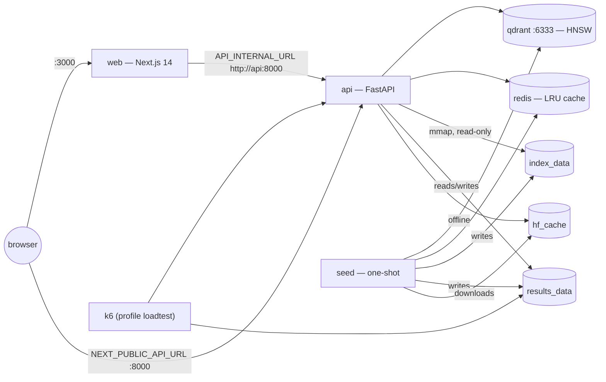
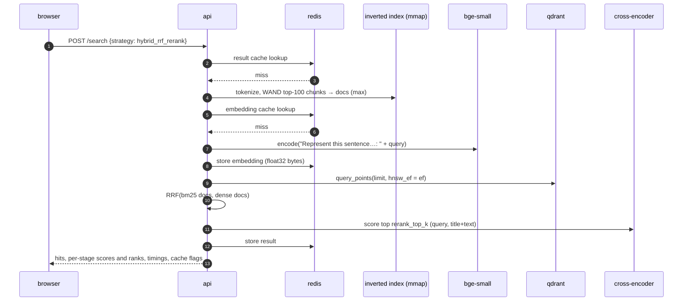
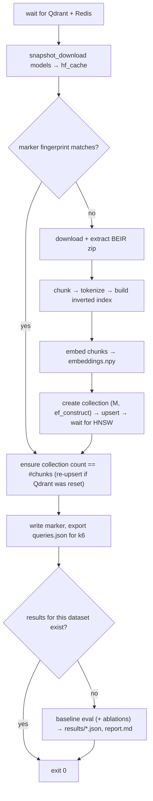

# HybridIR

[](https://github.com/your-org/hybridir/actions/workflows/ci.yml)
[](LICENSE)

**HybridIR is a hybrid search engine whose every stage is measured.** A hand-built BM25
inverted index (delta + varint compressed postings, skip pointers, WAND top-k) runs next to a
dense retriever (`BAAI/bge-small-en-v1.5` embeddings in Qdrant HNSW, or a from-scratch NumPy
HNSW). Their candidate lists are fused with Reciprocal Rank Fusion or normalized weighted
fusion and optionally reranked by a cross-encoder (`cross-encoder/ms-marco-MiniLM-L-6-v2`).
A built-in evaluation harness scores every strategy against BEIR relevance judgments
(nDCG, Recall, MRR, MAP, P), records per-stage latency, tests significance against BM25 with a
paired bootstrap, sweeps the important parameters, and draws the quality-versus-latency
Pareto frontier. A Next.js dashboard lets you search, compare strategies side by side, and
explain any document's rank down to the arithmetic.

> **What this project proves**
>
> - Which retrieval strategy (BM25, dense, two kinds of hybrid, with or without reranking)
>   gives the best ranking quality on a given BEIR dataset, **and whether the difference is
>   statistically significant** — see `results/summary.json → strategies[].significance`.
> - **What that quality costs in latency** at p50/p95/p99, stage by stage, with cold and warm
>   caches — `results/summary.json → latency_cold / latency_warm / stage_means_ms`.
> - **Which configurations are worth running at all** (the Pareto frontier) —
>   `results/pareto.json`.
> - That a from-scratch inverted index with WAND returns **exactly** the same top-k as
>   exhaustive scoring (`backend/tests/test_wand_matches_bruteforce.py`) and that a
>   from-scratch HNSW reaches recall@10 ≥ 0.9 against brute force on 5k vectors
>   (`backend/tests/test_custom_hnsw_recall.py`).
>
> No result in this README is typed by hand: the [Results](#14-results) section is rendered from
> `results/*.json` by `scripts/render_readme.py`.

---

## Table of contents

1. [Overview](#hybridir)
2. [Quickstart](#2-quickstart)
3. [Screens (wireframes)](#3-screens-wireframes)
4. [Architecture](#4-architecture)
5. [Information retrieval primer](#5-information-retrieval-primer)
6. [Evaluation primer](#6-evaluation-primer)
7. [Design decisions and trade-offs](#7-design-decisions-and-trade-offs)
8. [Module reference](#8-module-reference)
9. [Index internals](#9-index-internals)
10. [API reference](#10-api-reference)
11. [Frontend guide](#11-frontend-guide)
12. [Configuration reference](#12-configuration-reference)
13. [Running experiments](#13-running-experiments)
14. [Results](#14-results)
15. [Reproducibility checklist](#15-reproducibility-checklist)
16. [Performance tuning guide](#16-performance-tuning-guide)
17. [Limitations and threats to validity](#17-limitations-and-threats-to-validity)
18. [Troubleshooting, FAQ, glossary](#18-troubleshooting-faq-glossary)
19. [Extending the project](#19-extending-the-project)
20. [References and resume framing](#20-references-and-resume-framing)

---

## 2. Quickstart

### Prerequisites

- Docker Engine 24+ with **Docker Compose v2** (`docker compose version`).
- 8 GB RAM available to Docker (Docker Desktop: Settings → Resources), 4+ CPU cores recommended.
- Disk: see the table below. Outbound HTTPS to `huggingface.co` and
  `public.ukp.informatik.tu-darmstadt.de` on the **first** run only.
- `make` is optional; every target is a thin wrapper around `docker compose`.

### Three commands

```bash
git clone https://github.com/your-org/hybridir.git && cd hybridir
cp .env.example .env          # optional: every variable has a default
docker compose up --build     # or: make up   (detached)
```

| URL | What |
|---|---|
| <http://localhost:3000> | Web UI (Search, Compare, Explain, Metrics, Ablations, About) |
| <http://localhost:8000/docs> | Interactive OpenAPI docs |
| <http://localhost:8000/ready> | Readiness with a per-dependency report |
| <http://localhost:6333/dashboard> | Qdrant dashboard |

The `web` service starts only after `seed` has built everything and evaluated it, and `api`
reports ready. Follow progress with `docker compose logs -f seed` (each step prints a
`[n/8]` banner and an ETA).

### First-run time and disk (planning estimates)

These are rough planning figures for a 4–8 core laptop CPU, not measurements: the actual
build and embedding times of *your* run are recorded in `results/index_stats.json`
(`build_seconds`, `embedding_seconds`) and in the seed log.

| Dataset | Docs / test queries | Dominant first-run cost | First run (incl. image build) | Extra disk (volumes) |
|---|---|---|---|---|
| `scifact` (default) | 5,183 / 300 | embedding + baseline eval + ablations | ~15–35 min | ~0.6 GB (models ~0.3 GB, data/index/embeddings < 0.1 GB, Qdrant < 0.1 GB) |
| `nfcorpus` | 3,633 / 323 | same as scifact | ~15–35 min | ~0.6 GB |
| `fiqa` | 57,638 / 648 | embedding 57k passages on CPU | ~1–2.5 h (set `ABLATIONS_ON_SEED=false` to save time) | ~1 GB |

Images: the backend image (CPU-only torch) is roughly 2 GB, the web image roughly 200 MB.
Subsequent `docker compose up` runs skip everything the idempotency marker covers and start
in about a minute.

### Reset

```bash
make down      # stop containers, keep volumes (fast restart)
make reseed    # rebuild index, embeddings, collection and results (FORCE_RESEED=1)
make clean     # delete every volume: models, data, index, Qdrant, results
```

---

## 3. Screens (wireframes)

> Real screenshots go in `docs/img/` (`search.png`, `compare.png`, `explain.png`,
> `metrics.png`, `ablations.png`) once you have run the stack on your hardware.

**Search** (`/`)

```
┌ HybridIR  Search Compare Metrics Ablations About        ■BM25 ■Dense ■Fusion ■Rerank [Dark] ┐
│ Search                                                                                       │
│ [ query ......................................................... / ] [Search]                │
│ (BM25)(Dense)(Hybrid RRF)(Hybrid weighted)(Hybrid RRF+rerank)(...)            Results [10▾]  │
│ ▸ Parameters  k1 b rrf_k alpha norm rerank_top_k ef                       Override defaults  │
│ ┌──────────────────────────────────────────────┐  ┌ Latency ─────────────────────────┐       │
│ │ 1 Title (links to Explain)                   │  │ ████▓▓▓▓░░░░░░████████████       │       │
│ │   snippet …                                  │  │ BM25 · embed · ANN · fusion · rr │       │
│ │   bm25 · dense · fusion · rerank · doc id    │  ├ Parameters used ─────────────────┤       │
│ │ 2 …                                          │  │ k1 b rrf_k alpha … dense backend │       │
│ └──────────────────────────────────────────────┘  └──────────────────────────────────┘       │
```

**Compare** (`/compare?q=`): four equal columns (BM25, Dense, Hybrid RRF, Hybrid RRF +
rerank). Each card shows the document's rank in every column and a badge `↑n`, `↓n`, `=`
or `new` relative to BM25. Hovering a card outlines the same document in all columns; the
title opens Explain.

```
│ BM25          │ Dense          │ Hybrid (RRF)   │ Hybrid RRF + rerank │
│ 1 Doc A       │ 1 Doc C   [↑2] │ 1 Doc A   [=]  │ 1 Doc C        [↑2] │
│ 2 Doc B       │ 2 Doc A   [↓1] │ 2 Doc C   [↑1] │ 2 Doc E       [new] │
```

**Explain** (`/explain/{docId}?q=`): header with the document's rank under every strategy;
BM25 panel (bar chart of per-term contributions + tf/df/idf/length-norm/tf-part table);
dense cosine and cross-encoder cards; fusion arithmetic (RRF terms and weighted-fusion
normalization with the actual list min/max); full document with query terms highlighted.

**Metrics** (`/metrics`): table of all configurations (nDCG@10, Recall@100, MRR@10,
significance badge vs BM25, p50/p95/p99 cold, warm p95, QPS); Pareto scatter (nDCG@10 vs
p95) with the frontier joined; cache hit-rate card; inverted-index stats; k6 results when
present; collapsible environment block.

**Ablations** (`/ablations`): BM25 k1×b heatmap, alpha sweep lines (min-max vs z-score
with best RRF as reference), rerank depth (quality vs cross-encoder p95), RRF k table, HNSW
recall-vs-ef and latency-vs-ef per M, chunk-size table.

**About** (`/about`): SVG architecture of the query path and a link to this README.

---

## 4. Architecture

### Services



Startup order is enforced with healthchecks: `qdrant` and `redis` healthy → `seed` completes
successfully → `api` healthy on `/ready` → `web`.

### One hybrid + rerank query



### Seed data flow



More detail (failure isolation, concurrency, the chunk-id invariant):
[docs/architecture.md](docs/architecture.md).

---

## 5. Information retrieval primer

### 5.1 Tokenization

Text becomes index terms through a fixed pipeline (`core/tokenizer.py`):

1. **Unicode normalization** (NFKD) and removal of combining marks: *Café* → *cafe*.
2. **Lowercasing**.
3. **Regex tokenization** on runs of Unicode letters and digits (`[^\W_]+`):
   *COVID-19, IL-6* → `covid 19 il 6`.
4. **Stopword removal** (a short English list; aggressive lists hurt scientific text).
5. **Porter stemming**: *running, runs* → `run`.

The same analyzer must run at index and query time; its configuration is stored in the
index metadata and reloaded with it. Positions are counted after stopword removal, so the
phrase `"cancer of the lung"` becomes the adjacent pair (cancer, lung) on both sides.

### 5.2 The inverted index

An inverted index maps each term to its **postings list**: the sorted ids of the chunks that
contain it, each with the term frequency and positions. A query only touches the lists of its
own terms, so cost scales with the lengths of those lists, not with the corpus. Sorting by id
enables delta compression and merge-style traversal; see [§9](#9-index-internals).

### 5.3 From TF-IDF to BM25

TF-IDF scores a document by `tf(t, d) · idf(t)` summed over query terms. Two problems: raw tf
grows without bound (the tenth occurrence of *cancer* is worth as much as the first), and long
documents accumulate tf simply by being long.

BM25 (Robertson et al.) fixes both. With `N` chunks, `df(t)` chunks containing `t`, chunk
length `|d|` and average length `avgdl`:

$$
\text{score}(q, d) = \sum_{t \in q} \text{qtf}(t)\cdot \text{IDF}(t)\cdot
\frac{tf(t,d)\,(k_1 + 1)}{tf(t,d) + k_1\left(1 - b + b\,\frac{|d|}{\text{avgdl}}\right)}
$$

$$
\text{IDF}(t) = \ln\!\left(1 + \frac{N - df(t) + 0.5}{df(t) + 0.5}\right)
$$

- **k1** (saturation, typical 0.9–2.0): the tf fraction approaches `k1 + 1` asymptotically,
  so repeated occurrences add less and less. k1 = 0 reduces BM25 to binary presence × IDF.
- **b** (length normalization, 0–1): b = 0 ignores length; b = 1 fully divides tf by the
  length ratio. `1 − b + b·|d|/avgdl` is shown as *length norm* on the Explain page.
- **IDF with +1 smoothing**: the classic Robertson–Sparck Jones IDF
  `ln((N − df + 0.5)/(df + 0.5))` goes negative for terms in more than half the
  collection; adding 1 inside the log (the Lucene variant) keeps every weight positive, which
  WAND's upper-bound logic relies on.

### 5.4 Vector space and embeddings

A bi-encoder maps text to a vector in ℝ³⁸⁴ (bge-small) such that texts with related meaning
land close together, regardless of shared words. Queries get BGE's instruction prefix
`"Represent this sentence for searching relevant passages: "`; documents do not. All
vectors are L2-normalized, so

$$
\cos(u, v) = \frac{u\cdot v}{\lVert u\rVert\,\lVert v\rVert} = u\cdot v .
$$

Dense retrieval recovers paraphrases and synonyms BM25 misses (*heart attack* vs *myocardial
infarction*) but can miss exact identifiers, rare names and numbers that BM25 matches
trivially. That complementarity is the reason for hybrid retrieval.

### 5.5 Why exact kNN does not scale, and ANN

Exact nearest neighbors needs one dot product per stored vector: `O(N·d)` per query. At
57k × 384 that is cheap; at 100M vectors it is not, and it cannot be indexed by sorting.
**Approximate** nearest-neighbor methods accept a small recall loss for sub-linear search.

### 5.6 HNSW

Hierarchical Navigable Small World graphs (Malkov & Yashunin) build a multi-layer proximity
graph:

- **Layers.** Every vector is on layer 0; it is also on layers 1..ℓ where
  `ℓ = ⌊−ln(U(0,1)) · mL⌋`, `mL = 1/ln M`. Upper layers are exponentially sparser, like a skip
  list, and provide long-range "express" links.
- **Search.** Start at the entry point on the top layer, greedily move to the closest
  neighbor until no improvement, drop a layer, repeat; on layer 0 run a best-first search
  keeping a dynamic list of the `ef` (efSearch) best candidates. Return the top k.
- **Insertion.** Search for the new vector with list size **efConstruction**, choose up to
  **M** neighbors per layer (2M on layer 0) with a *heuristic* that prefers diverse
  neighbors (keep a candidate only if it is closer to the new node than to any neighbor
  already selected), add links both ways, and prune neighbors that exceed the degree limit.
- **Complexity.** Search is empirically ~`O(log N)` hops with `O(M)` distance computations
  each; memory is `O(N·M)` links plus the vectors; build is `O(N log N)`.
- **Knobs.** `M` ↑: better recall at fixed ef, more memory, slower build. `efConstruction`
  ↑: better graph, slower build. `ef` ↑: higher recall, slower queries (query-time only).

This project uses Qdrant's HNSW by default (`DENSE_BACKEND=qdrant`; small collections are
forced through the HNSW index so ablations measure HNSW, not Qdrant's full-scan fallback),
and ships a readable from-scratch version in `core/custom_hnsw.py`
(`DENSE_BACKEND=custom`).

### 5.7 Fusion

**Reciprocal Rank Fusion** (Cormack, Clarke & Büttcher, 2009):

$$
\text{RRF}(d) = \sum_{r \in \text{rankers}} \frac{1}{k + \text{rank}_r(d)}
$$

RRF uses only ranks, so BM25 scores (unbounded, query-dependent) and cosines (in [−1, 1])
never need to be put on one scale. The constant `k` (60 by convention) damps the advantage
of the very top ranks: with k = 60 the difference between rank 1 and rank 2 is small, so a
document ranked moderately well by *both* retrievers beats one ranked first by only one.
Worked example: a document at BM25 rank 1 and dense rank 3 gets `1/61 + 1/63 ≈ 0.03227`; a
document at rank 1 in one list and absent from the other gets `1/61 ≈ 0.01639`.

**Weighted score fusion** normalizes each list and takes a convex combination:

$$
S(d) = \alpha\,\hat{s}_{\text{dense}}(d) + (1-\alpha)\,\hat{s}_{\text{bm25}}(d),
\quad \hat{s}_{\text{minmax}} = \frac{s - \min}{\max - \min},
\quad \hat{s}_{\text{z}} = \frac{s - \mu}{\sigma}
$$

Pitfalls: min-max is dominated by the single best and worst scores in each list (one outlier
compresses everyone else); z-score assumes a roughly symmetric distribution and changes
meaning with list length; and a document missing from one list must get *some* value — here
the list's floor (0 for min-max, the minimum z for z-score). The alpha sweep in the
ablations shows how sensitive the result is.

### 5.8 Bi-encoders vs cross-encoders, and the rerank cost model

A **cross-encoder** reads `[CLS] query [SEP] passage [SEP]` jointly, so every query token
attends to every passage token. It is markedly more accurate at judging relevance than the
dot product of two independently computed vectors, but it cannot precompute anything: each
(query, candidate) pair is one forward pass. With `L` the truncated pair length
(`RERANK_MAX_LENGTH`) and `K` candidates, rerank cost is roughly `O(K · L²)` per query on CPU,
linear in `K`. Hence the standard cascade: cheap retrievers produce ~100 candidates, the
cross-encoder rescores only the top `RERANK_TOP_K`. The rerank-depth ablation measures where
that trade-off pays off.

---

## 6. Evaluation primer

### Qrels

BEIR ships *qrels*: `(query id, document id, grade)` triples produced by human assessors.
Grades may be binary (scifact, fiqa) or graded (nfcorpus uses 1–2). A grade > 0 means
relevant.

### nDCG@k, with a worked example

$$
\text{DCG@}k = \sum_{i=1}^{k} \frac{\text{rel}_i}{\log_2(i+1)},\qquad
\text{nDCG@}k = \frac{\text{DCG@}k}{\text{IDCG@}k}
$$

IDCG is the DCG of the *ideal* ranking: **all** judged grades for the query sorted
descending, not just the retrieved ones (a common bug, tested in `test_metrics.py`).

Toy example (not a result): qrels `a = 3, b = 2, c = 1`; system ranking `[b, x, a, y, c]`
where `x, y` are unjudged.

| i | doc | rel | log2(i+1) | gain |
|---|---|---|---|---|
| 1 | b | 2 | 1.000 | 2.000 |
| 2 | x | 0 | 1.585 | 0 |
| 3 | a | 3 | 2.000 | 1.500 |
| 4 | y | 0 | 2.322 | 0 |
| 5 | c | 1 | 2.585 | 0.387 |

DCG@5 = 3.887; ideal order `[a, b, c]` gives IDCG@5 = 3 + 2/1.585 + 1/2 = 4.762;
nDCG@5 = 3.887 / 4.762 = 0.816.

### Recall@k, MRR, MAP, P@k

- **Recall@k** = relevant found in top k / all relevant. In the toy example Recall@2 = 1/3.
  Recall@100 measures what a reranker *could* recover.
- **MRR@k** = 1 / rank of the first relevant document (1.0 in the example).
- **AP@k** = mean of precision at each relevant hit, divided by the total number of relevant
  documents: (1/1 + 2/3 + 3/5) / 3 = 0.756 in the example. **MAP** averages AP over queries.
- **P@k** = relevant in top k / k.

### Unjudged ≠ irrelevant

Only documents someone looked at are judged. A strong retriever that surfaces relevant but
never-judged documents is scored as if they were irrelevant. BEIR's pools were largely built
from lexical systems, which can understate dense retrieval. This is a known bias, not a bug;
`per_query.jsonl` lets you count unjudged documents in each top-10.

### Statistical significance and the paired bootstrap

Two systems evaluated on 300 queries differ by some mean nDCG@10. Would the difference
survive a different 300 queries? The **paired bootstrap** resamples queries with
replacement 10,000 times, recomputes the mean per-query difference each time, and reads a
95% confidence interval from the percentiles. The p-value comes from the same resampling on
differences shifted to have mean zero (the null hypothesis). Pairing matters: per-query
difficulty varies far more than the systems do, and pairing cancels it.

### Latency percentiles and why p99 matters

Means hide tails. p50 is the typical request; p95 and p99 are what one in 20 or one in 100
users experiences, and a page that fans out to several backend calls hits the tail of each.
The harness reports p50/p95/p99 per configuration plus the mean of each stage, so you can
see *which* stage creates the tail (usually the cross-encoder).

### Warm vs cold cache

A cache hit skips work, so cached latency says nothing about compute cost. The headline
numbers are **cold** (both caches bypassed). The **warm** column repeats the run with the
query-embedding cache primed: the difference is what caching embeddings buys you. Result-
cache hits are visible in the API (`cache.result_cache_hit`) and on the cache card, but are
never used for evaluation latency.

### Coordinated omission

A load tester that waits for each response before sending the next request sends *less*
load exactly when the server slows down, so slow periods are under-sampled and tail
latency looks better than it is. The k6 scripts use **arrival-rate** executors that schedule
requests on a clock, independent of responses ([loadtest/README.md](loadtest/README.md)).

The complete protocol is in [docs/eval-protocol.md](docs/eval-protocol.md).

---

## 7. Design decisions and trade-offs

| Decision | Chosen | Alternatives | Why | Cost |
|---|---|---|---|---|
| Sparse engine | Hand-built inverted index + WAND | Lucene/Elasticsearch, rank_bm25 | Every byte and every skipped posting is inspectable and testable; the point of the project | Pure-Python scoring is slower than Lucene on large corpora |
| Postings compression | Delta + varint, skip block every 64 | PForDelta, Elias-Fano, roaring | Simple, byte-aligned, decodes in plain Python | Worse ratio and speed than SIMD codecs |
| Top-k | WAND with exact per-term bounds | MaxScore, Block-Max WAND, exhaustive | Classic, exact, easy to verify against brute force | Block-Max WAND skips more on long lists |
| BM25 bounds for arbitrary k1/b | Store the Pareto front of (tf, dl) per term | Recompute at query time, loose bound | Exact bound for any (k1, b) from a handful of pairs | Slightly larger metadata |
| Phrase queries | Positional boost on candidates | Strict phrase filter | Keeps recall of the unquoted query | Phrase matches outside the candidate set are not boosted |
| Chunk → doc | Max of chunk scores | Sum, first-chunk only, MaxP+SumP | Standard (MaxP), robust to document length | Ignores multiple partial matches |
| Dense model | bge-small-en-v1.5 (384-d) | e5-small, MiniLM, bge-base | Strong for its size, CPU friendly | Lower quality than base/large models |
| Vector store | Qdrant HNSW (+ optional custom HNSW) | FAISS, pgvector, Milvus | Real HNSW knobs (M, ef_construct, ef), REST, healthchecks | Network hop per query |
| Fusion | RRF and weighted (min-max/z-score) | Learned fusion, CombSUM | Both standard, explainable, cheap | No learning |
| Reranker | MiniLM-L6 cross-encoder | bge-reranker, monoT5, LLM rerankers | Fast enough on CPU | Weaker than larger rerankers |
| Cache | Redis, fail-open | In-process LRU | Shared across replicas, observable hit rates | Extra service |
| Model weights | Downloaded by seed into `hf_cache` volume; api offline | Bake into image | Small, generic image; offline after first run | First run needs network |
| Metrics | Implemented by hand, unit-tested | pytrec_eval | Transparent, no C dependency | Must match trec_eval conventions (tested) |
| Results in docs | Rendered from JSON | Hand-written tables | Numbers cannot drift from evidence | Need `make readme` after runs |

---

## 8. Module reference

### `backend/app/core`

| File | Purpose | Key functions / classes | Complexity | Invariants |
|---|---|---|---|---|
| `tokenizer.py` | Analysis chain and phrase parsing | `Tokenizer.tokenize`, `parse_query`, `highlight_spans`, `normalize` | O(text length) | Same config at index and query time (stored in meta.json) |
| `inverted_index.py` | Chunking, build, serialization, mmap reader, cursors | `iter_chunks`, `build_index`, `InvertedIndex`, `PostingsCursor.next/advance/positions`, `encode_varint`, `decode_varint` | Build O(total tokens + V log V); `advance` O(log blocks + log B) | Postings strictly increasing; one skip entry per block; build byte-for-byte deterministic |
| `bm25.py` | BM25 scoring and top-k | `BM25Scorer.brute_force`, `wand`, `search`, `score_chunk` | brute force O(Σ df); WAND ≤ that, usually far less | `wand(q, k) == brute_force(q, k)` (ids, order, scores); ties broken by smaller chunk id |
| `dense.py` | Embedding wrapper with Redis cache | `Embedder.encode_query`, `encode_documents` | one forward pass per batch | Output L2-normalized float32; query prefix only on queries |
| `vector_store.py` | Dense backends | `QdrantStore` (create, upsert, wait_indexed, search, exact_search), `CustomHNSWStore`, `ExactStore` | per backend | Point id == chunk id; cosine distance |
| `custom_hnsw.py` | From-scratch HNSW | `CustomHNSW.add_items`, `search`, `brute_force`, `save`, `load` | search ~O(M·ef·log N) | Degree ≤ M (2M on layer 0); level ~ Geometric with mL = 1/ln M; seeded RNG |
| `fusion.py` | RRF and weighted fusion | `rrf`, `weighted_fusion`, `normalize_scores`, `list_stats` | O(n log n) | Deterministic tie-break by doc id; alpha ∈ [0, 1] |
| `reranker.py` | Cross-encoder wrapper | `Reranker.score`, `rerank` | O(K·L²) | Scores in input order; ties broken by doc id |
| `pipeline.py` | Strategies, per-stage timing, result cache, failure isolation | `SearchPipeline.search`, `bm25_candidates`, `dense_candidates`, `rerank_scores`, `StageUnavailable` | sum of stages | Always returns `eval_depth` docs when available; a missing stage raises `StageUnavailable(stage)` |
| `cache.py` | Redis helpers and counters | `Cache.get_bytes/set_bytes/get_json/set_json/stats/reset_stats` | O(1) | Never raises on Redis errors (fail-open) |
| `explain.py` | Score decomposition | `explain()` | a handful of searches | Term scores + phrase boost == reported BM25 score (tested) |

### `backend/app/eval`

| File | Purpose | Key functions | Invariants |
|---|---|---|---|
| `datasets.py` | Download/extract/parse BEIR | `download_dataset`, `load_dataset`, `iter_corpus`, `load_qrels`, `sha256_file` | Only test queries with ≥ 1 positive judgment; deterministic order |
| `metrics.py` | nDCG, Recall, MRR, MAP, P | `ndcg_at_k`, `recall_at_k`, `mrr_at_k`, `average_precision_at_k`, `precision_at_k`, `per_query_metrics`, `aggregate` | Unjudged = 0; IDCG from all judgments |
| `runner.py` | Evaluate every strategy | `run_baseline`, `evaluate_config`, `run_evaluation`, `environment_info` | Cold pass bypasses both caches; per-query rows kept for significance |
| `ablations.py` | Parameter grids | `bm25_grid`, `chunk_size_ablation`, `fusion_ablation`, `hnsw_ablation`, `rerank_ablation`, `run_ablations` | One knob at a time; skipped stages noted, never faked |
| `latency.py` | Latency summaries | `summarize`, `stage_means`, `qps` | Linear-interpolation percentiles |
| `stats.py` | Paired bootstrap | `paired_bootstrap` | Seeded; p never exactly 0 |
| `report.py` | All result files and Markdown | `write_summary`, `write_ablations`, `compute_pareto`, `render_markdown`, `write_report_md` | Standard library only; atomic writes |

### Other backend files

`main.py` (app factory, CORS, request-id middleware), `config.py` (all settings),
`schemas.py` (Pydantic models, mirrored by `frontend/src/lib/types.ts`), `deps.py` (state
loading that never raises), `logging_setup.py` (JSON logs with request id), `api/*.py`
(routers and uniform errors), `scripts/*.py` (seed, eval, ablations, index build, README
rendering).

---

## 9. Index internals

### On-disk layout

```
postings.bin
┌──────────────────────────────────────────────────────────────────────────┐
│ header 16 B: "HYBRIDIX" | u32 version=1 | u32 reserved                   │
├──────────────────────────────────────────────────────────────────────────┤
│ term "aaa"  (terms in lexicographic order; offset/length in meta.json)   │
│   varint n_blocks                                                        │
│   n_blocks × skip entry: varint first_doc | varint last_doc              │
│                          | varint prev_doc+1 | varint data_offset        │
│   postings data, per posting:                                            │
│     varint doc_delta | varint tf | varint pos_nbytes | pos deltas ...    │
├──────────────────────────────────────────────────────────────────────────┤
│ term "aab" ...                                                           │
├──────────────────────────────────────────────────────────────────────────┤
│ padding to 4 B | u32 doc_lengths[n_chunks]  (np.frombuffer over mmap)    │
└──────────────────────────────────────────────────────────────────────────┘
meta.json        {tokenizer, n_chunks, avgdl, build k1/b, doclen_offset,
                  chunks: [[doc_id, chunk_no], ...],
                  terms: {term: [df, offset, length, max_score, pareto_front]}}
build_stats.json {build_seconds, peak_rss_mb, sizes, compression_ratio, ...}
```

The reader `mmap`s `postings.bin`; only the blocks a query touches are paged in. Terms are
written in sorted order and JSON is dumped with sorted keys, so two builds of the same input
are byte-identical (`test_build_is_deterministic`).

### Varint and delta encoding, worked

A varint stores 7 bits per byte, least significant group first; the high bit says "more
bytes follow". 300 = `0b1_0010_1100` → low 7 bits `010_1100` with the continuation bit →
`0xAC`, then the remaining `0b10` → `0x02`: bytes `AC 02`.

Doc ids are delta-encoded with an initial previous value of −1, so the first delta is
`id + 1` and every delta is ≥ 1. Postings for ids `[3, 7, 8, 200]`:

| id | delta | varint bytes |
|---|---|---|
| 3 | 3 − (−1) = 4 | `04` |
| 7 | 4 | `04` |
| 8 | 1 | `01` |
| 200 | 192 | `C0 01` |

Five bytes instead of sixteen for four u32 ids. Positions inside a posting are
delta-encoded the same way, and their byte length is stored first so a reader can skip
them without decoding.

### Skip pointers, walked through

With `SKIP_INTERVAL = 4`, a list of 10 postings has blocks starting at postings 0, 4, 8.
Each block's skip entry records its first and last doc id, the doc id preceding the block
(+1, so it stays unsigned), and the byte offset of its first posting. A cursor that needs
`advance(target)`:

1. If the current doc ≥ target: done.
2. If target ≤ current block's `last_doc`: binary-search inside the already decoded block.
3. Otherwise binary-search the `last_doc` array for the first block whose last doc ≥
   target, jump to its byte offset, start delta-decoding from its `prev_doc`, then
   binary-search inside it. Every block in between is never decoded
   (`PostingsCursor.blocks_skipped` counts them; `test_skip_pointers_advance` asserts > 0).

### WAND, walked through

WAND keeps a min-heap of the best k scores so far; its root is the threshold θ. Each term
`t` has an upper bound `UB(t)` = the largest contribution it can make to any chunk
(computed exactly from the stored Pareto front of (tf, length) pairs for the current
k1, b). Loop:

1. Sort cursors by current doc id.
2. Walk them accumulating UBs; the first cursor where the sum reaches θ is the **pivot**.
   No chunk before the pivot's doc can reach θ (its matching terms' UBs sum below θ).
3. If the first cursor is already on the pivot doc, every cursor up to the pivot is on it:
   score that chunk fully, push it if it beats θ, advance those cursors.
4. Otherwise advance one lagging cursor (the one with the largest UB) to the pivot doc with
   skip pointers and repeat.

Toy example: query `{rare, common}` with `UB(rare) = 5.0`, `UB(common) = 0.8`, k = 1,
current θ = 3.2. Cursors: `common` at doc 10, `rare` at doc 40. Sorted: common(10),
rare(40). Accumulate: 0.8 < 3.2; 0.8 + 5.0 ≥ 3.2 → pivot = rare at doc 40. The first
cursor (common) is behind, so it jumps straight to doc ≥ 40; docs 10–39, which only contain
`common` and can score at most 0.8, are never scored. Ties at equal score are broken by
smaller chunk id in both WAND and the reference, which is why the test can require
identical output.

---

## 10. API reference

Base URL `http://localhost:8000`. Interactive docs at `/docs`, schema at `/openapi.json`.
Every non-2xx body is `{"error": str, "detail": str, "stage": str|null, "request_id": str|null}`.
Every response carries `X-Request-ID` (echoed if you send one) and `X-Response-Time-ms`.
Example responses below show **shapes**; `<float>` stands for values your run produces.

### `GET /health`

Liveness. `200 {"status": "ok"}`.

### `GET /ready`

Readiness of every dependency; `200` when all ok, else `503` with the same body.

```bash
curl -s localhost:8000/ready
```
```json
{"ready": true, "dataset": "scifact", "dense_backend": "qdrant",
 "checks": {"index": {"ok": true, "detail": "<n> chunks, <n> terms"},
            "embedder": {"ok": true, "detail": "loaded"},
            "reranker": {"ok": true, "detail": "loaded"},
            "redis": {"ok": true, "detail": "ok"},
            "qdrant": {"ok": true, "detail": "scifact_m16_efc100: <n> points"}}}
```

### `POST /search`

| Field | Type | Default | Notes |
|---|---|---|---|
| `query` | string 1–512 | – | quote ≥ 2 words for a phrase boost |
| `strategy` | `bm25` \| `dense` \| `hybrid_rrf` \| `hybrid_weighted` \| `hybrid_rrf_rerank` \| `hybrid_weighted_rerank` | `hybrid_rrf` | |
| `top_k` | int 1–100 | 10 | hits returned (the pipeline always ranks `EVAL_DEPTH`) |
| `params` | object | `{}` | any of `k1` (0–5), `b` (0–1), `rrf_k` (1–1000), `alpha` (0–1), `norm` (`minmax`/`zscore`), `rerank_top_k` (1–200), `ef` (1–1024), `candidate_depth` (10–1000) |
| `use_cache` | bool | true | false bypasses result and embedding caches |

```bash
curl -s localhost:8000/search -H 'Content-Type: application/json' -d '{
  "query": "vitamin D supplementation and fracture risk",
  "strategy": "hybrid_rrf_rerank", "top_k": 5, "params": {"rerank_top_k": 30, "ef": 128}}'
```
```json
{"query": "vitamin D supplementation and fracture risk", "strategy": "hybrid_rrf_rerank", "top_k": 5,
 "params": {"k1": 1.2, "b": 0.75, "rrf_k": 60, "alpha": 0.5, "norm": "minmax",
            "rerank_top_k": 30, "ef": 128, "candidate_depth": 100},
 "hits": [{"rank": 1, "doc_id": "<doc id>", "title": "<title>", "snippet": "<text window>", "score": "<float>",
           "scores": {"bm25": "<float>", "dense": "<float>", "fusion": "<float>", "rerank": "<float>"},
           "ranks": {"bm25": 3, "dense": 1, "fusion": 1, "rerank": 1}, "chunk_id": 1234}],
 "total_candidates": 100, "query_terms": ["vitamin", "d", "supplement", "fractur", "risk"],
 "timings": {"tokenize_ms": "<float>", "bm25_ms": "<float>", "embed_ms": "<float>", "ann_ms": "<float>",
             "fusion_ms": "<float>", "rerank_ms": "<float>", "total_ms": "<float>"},
 "cache": {"result_cache_hit": false, "embedding_cache_hit": false},
 "dense_backend": "qdrant"}
```

The parameters echoed in the response are the server defaults from `.env`, overridden by
your `params`. A stage that cannot run returns `503` with `error: "stage_unavailable"` and `stage: "dense"` or `"rerank"`;
strategies that do not need that stage keep working.

### `POST /compare`

Body `{"query": str, "strategies": [Strategy] (default bm25, dense, hybrid_rrf, hybrid_rrf_rerank), "top_k": int (≤ 50), "params": {}}`.

```bash
curl -s localhost:8000/compare -H 'Content-Type: application/json' -d '{"query": "statins and dementia", "top_k": 10}'
```

Returns `results[]` (one `SearchResponse` or `error` per strategy) and `rank_shift[]`: for
every document shown in any column, `ranks` (1-based rank within each strategy's top 100),
`delta_vs_bm25` (= BM25 rank − strategy rank; positive = moved up) and `is_new` (absent from
BM25's top 100).

### `GET /explain?query=&doc_id=`

Optional `k1, b, rrf_k, alpha, norm, rerank_top_k, ef`.

```bash
curl -s 'localhost:8000/explain?query=%22vitamin%20d%22%20fracture&doc_id=<doc id>'
```

Returns per-term `{term, qtf, tf, df, idf, doc_len, avg_doc_len, length_norm, tf_component, score}`
for the document's best chunk, `bm25_score` (= Σ term scores + `phrase_boost`), `cosine`,
`fusion` (ranks in each candidate list, `1/(k+rank)` terms, raw and normalized scores with
the list min/max/mean/std, weighted score), `rerank_score`, `ranks` under every strategy,
`delta_vs_bm25`, and character spans to highlight in the title and text. 404 for an unknown
`doc_id`.

### `GET /metrics/summary`

Contents of `results/summary.json`, `index_stats.json`, `pareto.json` and (if present)
`k6_summary.json`. Before the first evaluation it returns `available: false` with a message telling you to run `make eval`.

### `GET /metrics/ablations`

Contents of `results/ablations.json`: `bm25_grid`, `chunk_size`, `rrf_k`, `alpha_sweep`,
`hnsw`, `rerank_top_k`, `notes`.

### `GET /metrics/cache`

`{enabled, redis_ok, embedding_hits, embedding_misses, result_hits, result_misses,
embedding_hit_rate, result_hit_rate, keys, used_memory_bytes}`. Counters reset after each
evaluation run.

### `POST /admin/eval` and `GET /admin/eval/status`

Require `ADMIN_TOKEN` to be set and sent as `X-Admin-Token` (403 if unset, 401 if wrong).

```bash
curl -s -X POST localhost:8000/admin/eval -H "X-Admin-Token: $ADMIN_TOKEN" \
     -H 'Content-Type: application/json' -d '{"include_ablations": false, "max_queries": 100}'
curl -s localhost:8000/admin/eval/status -H "X-Admin-Token: $ADMIN_TOKEN"
```

`202` with an `EvalStatus` body whose `state` is `"running"`; `409` if a run is in progress. The run writes the
same files as `make eval` and competes with live traffic for CPU.

---

## 11. Frontend guide

Next.js 14 App Router, strict TypeScript (no `any`), Tailwind, Recharts.

| Route | Rendering | Data | Components |
|---|---|---|---|
| `/` | client | `POST /search` | `SearchBar`, `StrategyToggle`, `ParamDrawer`, `ResultColumn`, `LatencyBreakdownBar`, `Skeletons`, `ErrorNotice` |
| `/compare` | client | `POST /compare` | `ResultColumn` ×4 with `RankShiftBadge`, hover sync |
| `/explain/[docId]?q=` | server | `GET /explain` | `ExplainPanel` → `TermContributionChart`, `FusionMathTable`, `RankShiftBadge` |
| `/metrics` | server | `GET /metrics/summary`, `/metrics/cache` | `MetricsTable`, `ParetoChart`, `CacheStatsCard` |
| `/ablations` | server | `GET /metrics/ablations` | `AblationHeatmap`, `AblationCharts` (alpha, rerank, HNSW) |
| `/about` | static | – | inline SVG architecture |
| `/api/health` | route handler | – | container healthcheck |

**Two API URLs.** Client components run in the browser and call `NEXT_PUBLIC_API_URL`
(default `http://localhost:8000`), which is inlined into the bundle at **build** time. Server
components run inside the `web` container, where `localhost` is the container itself, so
they call `API_INTERNAL_URL` (`http://api:8000`, read at **runtime**). `lib/api.ts` picks the
right one with `typeof window`.

**Rank shift.** The api returns, per document, its rank within each strategy's top-100 list
and `delta = bm25_rank − strategy_rank`. `lib/rankShift.ts::describeShift` maps that to
`↑n` (moved up), `↓n` (moved down), `=` or `new` (not in BM25's top 100); `computeRankShift`
recomputes the same rows from raw rankings.

**Theme and color system.** Light/dark via a `dark` class (stored in `localStorage`, system
preference by default, applied before paint). Each pipeline stage has one color used
everywhere: BM25 amber, dense teal, fusion violet, rerank rose — score labels, latency
segments, chart series, strategy names.

**Keyboard.** `/` focuses the search box from anywhere on a page.

**Types.** `lib/types.ts` mirrors `backend/app/schemas.py` field for field.

---

## 12. Configuration reference

All variables are read by `backend/app/config.py` (backend) or the web container. Defaults
are in `docker-compose.yml` and documented in `.env.example`. **[reseed]** = changes built
artifacts; run `make reseed` after changing.

| Variable | Default | Range | Effect |
|---|---|---|---|
| `DATASET` [reseed] | `scifact` | scifact, nfcorpus, fiqa | BEIR dataset |
| `BEIR_BASE_URL` | UKP BEIR mirror | URL | where `<dataset>.zip` is downloaded from |
| `DATA_DIR` / `RESULTS_DIR` / `HF_HOME` | `/data` / `/results` / `/hf_cache` | paths | set by compose to the named volumes; change only outside Docker |
| `QDRANT_URL` / `REDIS_URL` | `http://qdrant:6333` / `redis://redis:6379/0` | URLs | set by compose |
| `QDRANT_TIMEOUT_SECONDS` / `REDIS_TIMEOUT_SECONDS` | 10 / 1 | > 0 | client timeouts (Redis fails open) |
| `HF_HUB_OFFLINE` | api `1`, seed `0` | 0/1 | set by compose; api never downloads |
| `API_PORT` / `WEB_PORT` / `QDRANT_PORT` | 8000 / 3000 / 6333 | ports | host port mappings |
| `NEXT_PUBLIC_API_URL` | `http://localhost:8000` | URL | browser → api (build time; rebuild `web`) |
| `NEXT_PUBLIC_README_URL` | repo URL | URL | About page link |
| `CORS_ORIGINS` | `http://localhost:3000` | comma list | allowed browser origins |
| `EMBED_MODEL` [reseed] | `BAAI/bge-small-en-v1.5` | HF repo | bi-encoder |
| `RERANK_MODEL` | `cross-encoder/ms-marco-MiniLM-L-6-v2` | HF repo | cross-encoder |
| `EMBED_BATCH_SIZE` | 32 | 1–512 | embedding batch (RAM vs speed) |
| `RERANK_BATCH_SIZE` | 32 | 1–512 | cross-encoder batch |
| `RERANK_MAX_LENGTH` | 256 | 16–512 | tokens per (query, passage) pair; cost ~ quadratic |
| `TORCH_THREADS` | 0 | 0–64 | torch intra-op threads (0 = default) |
| `USE_STEMMER` / `USE_STOPWORDS` [reseed] | true / true | bool | analyzer |
| `MIN_TOKEN_LEN` [reseed] | 1 | 1–10 | drop shorter tokens |
| `CHUNK_SIZE` [reseed] | 256 | 0–8192 | words per chunk, 0 = no chunking |
| `CHUNK_OVERLAP` [reseed] | 32 | 0–4096 | words shared by consecutive chunks |
| `SKIP_INTERVAL` [reseed] | 64 | 2–4096 | postings per skip block |
| `DENSE_BACKEND` [reseed] | `qdrant` | qdrant, custom | ANN implementation |
| `BM25_K1` | 1.2 | 0–5 | saturation (exact WAND bounds precomputed for the build value) |
| `BM25_B` | 0.75 | 0–1 | length normalization |
| `PHRASE_BOOST` | 1.0 | 0–100 | boost per matched quoted phrase × Σ idf |
| `HNSW_M` [reseed] | 16 | 4–128 | graph degree |
| `HNSW_EF_CONSTRUCT` [reseed] | 100 | 8–1024 | build breadth |
| `HNSW_EF` | 64 | 1–1024 | query breadth |
| `RRF_K` | 60 | 1–1000 | RRF constant |
| `FUSION_ALPHA` | 0.5 | 0–1 | dense weight in weighted fusion |
| `FUSION_NORM` | `minmax` | minmax, zscore | normalization for weighted fusion |
| `CANDIDATE_DEPTH` | 100 | 10–1000 | candidates per retriever |
| `RERANK_TOP_K` | 50 | 1–200 | candidates reranked |
| `EVAL_DEPTH` | 100 | 10–1000 | ranking depth kept for evaluation |
| `CACHE_ENABLED` | true | bool | Redis caching |
| `CACHE_TTL_SECONDS` | 3600 | ≥ 1 | entry lifetime |
| `REDIS_MAXMEMORY` | 256mb | size | Redis memory cap (allkeys-lru) |
| `ADMIN_TOKEN` | empty | string | enables `/admin/*` |
| `SEARCH_TIMEOUT_SECONDS` | 30 | > 0 | per-request timeout (504) |
| `LOG_LEVEL` | INFO | DEBUG…ERROR | log verbosity |
| `FORCE_RESEED` | false | bool | ignore the idempotency marker |
| `SEED_WAIT_TIMEOUT_SECONDS` | 180 | ≥ 1 | how long seed waits for Qdrant/Redis |
| `EVAL_MAX_QUERIES` | 0 | ≥ 0 | 0 = all test queries |
| `EVAL_QPS_QUERIES` / `EVAL_QPS_THREADS` | 100 / 4 | ≥ 1 | concurrent throughput run |
| `EVAL_WARM_PASS` | true | bool | measure warm embedding cache |
| `ABLATIONS_ON_SEED` | true | bool | run ablations during the first seed |
| `ABLATION_MAX_QUERIES` | 0 | ≥ 0 | 0 = all |
| `ABLATION_LATENCY_SAMPLE` | 50 | ≥ 1 | queries timed per rerank depth |
| `BOOTSTRAP_RESAMPLES` | 10000 | ≥ 100 | bootstrap iterations |
| `RANDOM_SEED` | 42 | int | bootstrap, HNSW levels, k6 query sample |
| `K6_QUERY_SAMPLE` | 200 | ≥ 1 | queries exported for k6 |
| `K6_SCRIPT` | `k6_search.js` | file | which k6 script `make load` runs |
| `K6_*_RATE`, `K6_STAGE_SECONDS`, `K6_P95_MS`, `K6_RERANK_P95_MS` | see `.env.example` | | load profile and thresholds |

Per-request overrides (`params` in `/search`) exist for `k1, b, rrf_k, alpha, norm,
rerank_top_k, ef, candidate_depth`.

---

## 13. Running experiments

| Goal | Command | Writes |
|---|---|---|
| Baseline evaluation, all strategies | `make eval` | `summary.json/.csv`, `per_query.jsonl`, `index_stats.json`, `pareto.json`, `report.md` |
| Quick iteration on a subset | `docker compose run --rm seed python -m scripts.run_eval --max-queries 50` | same |
| Baseline + every ablation | `docker compose run --rm seed python -m scripts.run_eval --ablations` | + `ablations.json`, `ablations_*.csv` |
| One ablation | `ONLY=hnsw make ablations` (or `bm25_grid`, `chunk_size`, `fusion`, `rerank_top_k`, comma separated) | merges into `ablations.json` |
| Other dataset | set `DATASET=fiqa` in `.env`, then `make reseed` | everything, for that dataset |
| From-scratch HNSW backend | `DENSE_BACKEND=custom` in `.env`, `make reseed` | `custom_hnsw.npz`, results |
| Load test per strategy | `make load` | `k6_summary.json`, `k6_search_raw.json` |
| Mixed load test | `make load-mixed` | `k6_summary.json`, `k6_mixed_raw.json` |
| Export results to the host | `make results` | `./results/` |
| Update this README | `make readme` | the Results section below |

**Reading the outputs.** `summary.json → strategies[]` has, per configuration: `metrics`
(seven metrics), `latency_cold`/`latency_warm` (`n, mean, p50, p95, p99, max` in ms),
`stage_means_ms`, `qps`, and `significance` vs BM25 (`mean_delta, ci_low, ci_high,
p_value, significant`). `per_query.jsonl` has one line per (configuration, query) with
metrics, latency and the top-100 ranking — use it for error analysis (which queries did
reranking fix or break?). `report.md` renders all of it as tables.

**Custom datasets.** Any BEIR-format folder works: put `corpus.jsonl`, `queries.jsonl` and
`qrels/test.tsv` under `/data/<name>/raw` in the `index_data` volume, add `<name>` to the
`DatasetName` literal in `config.py`, set `DATASET=<name>` and reseed. The download step is
skipped when the files already exist.

---

## 14. Results

<!-- RESULTS:START -->
_No results yet. Run `make eval` to populate._
<!-- RESULTS:END -->

How to regenerate: run the stack (or `make eval`), then `make readme`. The renderer
(`backend/scripts/render_readme.py`) uses only the Python standard library and replaces
everything between the two markers, so hand edits inside the block are overwritten.

---

## 15. Reproducibility checklist

When publishing any number from this project, report:

- [ ] **Hardware:** CPU model, physical/logical cores, RAM, OS; Docker Desktop VM limits if
      applicable. (`summary.json → environment` records platform, cores, RAM, torch threads.)
- [ ] **Software:** image digests or the commit hash; pinned versions are in
      `backend/requirements-*.txt`, `frontend/package-lock.json` and `docker-compose.yml`.
- [ ] **Dataset:** name, split (test), number of evaluated queries (`n_queries`), and
      `dataset_zip_sha256` from the environment block.
- [ ] **Models:** embedding and reranker repos (recorded); pin revisions if you need
      bit-exact reproducibility over time.
- [ ] **Configuration:** the full `.env`, in particular `DENSE_BACKEND`, HNSW parameters,
      `CHUNK_SIZE`, `RERANK_TOP_K`, `CANDIDATE_DEPTH`.
- [ ] **Seeds:** `RANDOM_SEED` (bootstrap, HNSW level generation, k6 sample). Index builds are
      deterministic; Qdrant's HNSW construction is multi-threaded and not guaranteed
      bit-identical across runs.
- [ ] **Cache state** for every latency figure (cold, warm embedding cache).
- [ ] **Significance:** CI and p-value from `summary.json`, plus a multiple-comparison note
      if you compare several systems.

---

## 16. Performance tuning guide

| Want | Change | Cause → effect |
|---|---|---|
| Lower hybrid+rerank latency | `RERANK_TOP_K` ↓ (e.g. 20) | cross-encoder cost is linear in candidates; check the rerank ablation for the quality knee |
| | `RERANK_MAX_LENGTH` ↓ | attention cost ~ L²; truncates long passages |
| | `TORCH_THREADS` = physical cores | avoids oversubscription when several requests run |
| Lower dense latency | `HNSW_EF` ↓ | fewer graph nodes visited; recall drops (HNSW ablation) |
| | keep the embedding cache warm | repeated queries skip the encoder |
| Higher dense recall | `HNSW_EF` ↑, then `HNSW_M` ↑ [reseed] | wider search; denser graph |
| Higher hybrid recall@100 | `CANDIDATE_DEPTH` ↑ | more documents survive into fusion; fusion cost is negligible, rerank is not |
| Better BM25 | tune `BM25_K1`, `BM25_B` from the heatmap | dataset-specific; short documents prefer lower b |
| Lower BM25 latency | `SKIP_INTERVAL` ↓ [reseed] | finer skipping for WAND on long lists; bigger skip tables |
| | stop/stem on | shorter postings, fewer terms |
| Less memory during seed | `EMBED_BATCH_SIZE` ↓ | smaller activations |
| Faster first run | `ABLATIONS_ON_SEED=false`, `EVAL_WARM_PASS=false` | skips the most expensive evaluation work |
| Throughput | more api replicas sharing Redis and the index volume | the index is read-only mmap, cache is shared |

---

## 17. Limitations and threats to validity

- **Small corpora.** scifact and nfcorpus have a few thousand documents and ~300 queries.
  Differences of a point or two of nDCG@10 are often within the bootstrap CI; ANN effects are
  muted because an exact scan is already cheap.
- **Pooling bias.** Unjudged documents count as irrelevant; BEIR pools favour lexical
  systems, which can understate dense and hybrid methods ([§6](#6-evaluation-primer)).
- **BEIR-specific behaviour.** scifact queries are claims and its judgments come from
  evidence annotation; fiqa is opinionated financial QA; nfcorpus is medical with graded
  judgments. Conclusions about the "best" strategy do not transfer automatically.
- **Out-of-domain models.** bge-small and the MS MARCO cross-encoder were not fine-tuned on
  these datasets; a cross-encoder can *hurt* on domains unlike MS MARCO, which the
  significance test will show.
- **CPU-only, single process.** Latencies reflect CPU inference with one uvicorn worker; GPU
  inference or batching across requests changes the latency picture completely.
- **In-process latency.** Headline latencies exclude HTTP and JSON; k6 numbers include them.
- **Chunking.** Whitespace windows with the title prepended and max aggregation; the chunk
  ablation covers BM25 only, the dense index is embedded once at the default size.
- **Phrase boost** is applied to candidates only and is not part of the WAND bound.
- **Multiple comparisons.** Five systems are compared with BM25; raw p-values are reported
  without correction.
- **Qdrant non-determinism.** HNSW construction in Qdrant is parallel; recall can vary slightly
  between rebuilds.

---

## 18. Troubleshooting, FAQ, glossary

### Troubleshooting

| Symptom | Cause | Fix |
|---|---|---|
| `seed` exits 1 waiting for services | Qdrant/Redis not healthy in time | `docker compose logs qdrant redis`; raise `SEED_WAIT_TIMEOUT_SECONDS` |
| `seed` cannot download dataset/models | No outbound HTTPS on first run | Allow network once, or copy the zip/model cache into the volumes ([docs/troubleshooting.md](docs/troubleshooting.md)) |
| `api` never healthy | a `/ready` check fails | `curl localhost:8000/ready` names the failing dependency |
| Hybrid/dense 503 `stage: dense` | Qdrant down or collection missing | `make seed` re-upserts from `embeddings.npy`; BM25 still works |
| Rerank 503 `stage: rerank` | cross-encoder not loaded (memory/weights) | more Docker memory; `make seed`; restart api |
| 504 timeouts | CPU saturated (large rerank depth, parallel eval/load test) | lower `rerank_top_k`, raise `SEARCH_TIMEOUT_SECONDS` |
| Browser cannot reach API | `NEXT_PUBLIC_API_URL` not reachable from browser, or CORS | set it and rebuild `web`; add origin to `CORS_ORIGINS` |
| Metrics/Ablations pages empty | no results yet | `make eval`, `make ablations` |
| `.env` change ignored | artifact or bundle built with old value | `make reseed` for [reseed] vars; `docker compose build web` for `NEXT_PUBLIC_*` |
| OOM on fiqa | embedding batch too large | `EMBED_BATCH_SIZE=16`, give Docker ≥ 6 GB |

The full table is in [docs/troubleshooting.md](docs/troubleshooting.md).

### FAQ

**Why write BM25 by hand instead of using Elasticsearch?** To make every part measurable
and testable: compression ratio, skipped blocks, WAND's fully-scored count, and an exact
equality test against brute force. Elasticsearch would be faster and is what you would use in
production.

**Is WAND approximate?** No. With exact upper bounds it returns the same top-k as exhaustive
scoring; it only avoids scoring chunks that provably cannot enter the top k.

**Why can't I see numbers in this README?** Because none have been generated on your
machine. Run the stack and `make readme`. Numbers measured on someone else's hardware would
be misleading.

**Can I use a GPU?** Install a CUDA torch in the backend image and change `device="cpu"` in
`core/dense.py` and `core/reranker.py`; report it, because it changes every latency.

**Why does hybrid sometimes lose to BM25?** Fusion can only help when the retrievers are
both good and different. On datasets where one is much weaker, it adds noise; the alpha sweep
and RRF-k ablation show this directly.

**Why are rerank scores negative?** They are logits, not probabilities; only their order
matters.

**Does the result cache distort evaluation?** No. The evaluation harness bypasses it; it only
serves interactive traffic.

**How do I evaluate my own data?** See *Custom datasets* in [§13](#13-running-experiments).

### Glossary

| Term | Meaning |
|---|---|
| Ablation | Experiment changing one parameter at a time |
| ANN | Approximate nearest-neighbor search |
| avgdl | Average chunk length in terms |
| b | BM25 length-normalization strength (0–1) |
| BEIR | Heterogeneous retrieval benchmark (Thakur et al.) |
| Bi-encoder | Encodes query and document separately; dot-product similarity |
| BM25 | Probabilistic ranking function with tf saturation and length normalization |
| Bootstrap | Resampling to estimate uncertainty; paired over queries here |
| Candidate depth | Documents each retriever contributes to fusion |
| Chunk | Indexed window of a document (title + words) |
| Coordinated omission | Load-test bias hiding tail latency |
| Cosine similarity | Normalized dot product |
| Cross-encoder | Joint query–passage transformer scorer |
| DAAT / TAAT | Document-/term-at-a-time query processing |
| DCG / nDCG | Rank-discounted graded gain, normalized by the ideal |
| Delta encoding | Storing gaps between sorted integers |
| df | Number of chunks containing a term |
| ef / efSearch | HNSW query candidate-list size |
| efConstruction | HNSW build candidate-list size |
| Embedding | Dense vector representation of text |
| Fusion | Merging ranked lists |
| HNSW | Hierarchical Navigable Small World graph |
| IDF | Inverse document frequency |
| Inverted index | Term → postings map |
| k1 | BM25 term-frequency saturation |
| M | HNSW neighbors per node |
| MAP | Mean Average Precision |
| Max aggregation | Document score = best chunk score |
| mmap | Memory-mapped file access |
| mL | HNSW level multiplier 1/ln M |
| MRR | Mean Reciprocal Rank |
| Pareto frontier | Non-dominated quality/latency configurations |
| Percentile | p50/p95/p99 latency |
| Phrase query | Quoted words matched by position |
| Postings list | Sorted (chunk, tf, positions) for one term |
| Precision@k | Relevant fraction of the top k |
| Qrels | Relevance judgments |
| QPS | Queries per second |
| Recall@k | Fraction of relevant documents in the top k |
| Reranking | Re-scoring candidates with a stronger model |
| RRF | Reciprocal Rank Fusion |
| Skip pointer | Block entry enabling jumps within a postings list |
| Stemming | Reducing words to stems |
| Stopwords | Removed function words |
| tf | Term frequency in a chunk |
| Unjudged | Document without a qrel (scored 0) |
| Varint | 7-bits-per-byte integer encoding |
| WAND | Weak-AND dynamic-pruning top-k algorithm |
| Weighted fusion | Convex combination of normalized scores |
| z-score | (s − mean) / std normalization |

Longer definitions: [docs/glossary.md](docs/glossary.md).

---

## 19. Extending the project

**Add a dataset.** Add the name to `DatasetName` in `backend/app/config.py`. If it is on the
BEIR server it downloads automatically; otherwise place BEIR-format files under
`/data/<name>/raw`. Set `DATASET` and `make reseed`.

**Add a retriever (e.g. SPLADE).** Implement candidates as a doc-level `list[(doc_id,
score)]` (see `SearchPipeline.bm25_candidates`). A learned sparse model can reuse the
inverted index: store integer-quantized term weights instead of tf, and replace
`bm25_term_weight` with the stored weight (WAND bounds become per-term max weights). Add a
strategy name to the `Strategy` literal in `pipeline.py` and `schemas.py`, mirror it in
`frontend/src/lib/types.ts`, and extend `needs_sparse`/`fusion_kind`. The runner picks up
every entry in `STRATEGIES` automatically.

**Add a reranker.** Implement the `PairScorer` protocol (`predict(pairs) -> scores`) and pass
it to `Reranker(model=...)`, or set `RERANK_MODEL` to another sentence-transformers
cross-encoder. For LLM rerankers, wrap the call in `predict` and expect very different latency.

**Swap the vector store.** Implement the `DenseSearcher` protocol (`name`, `search(vector, k,
ef)`, `health()`), return chunk ids, and select it in `deps.build_dense_searcher`. FAISS,
pgvector or hnswlib all fit. The HNSW ablation's ground truth is an exact NumPy scan of
`embeddings.npy`, so a new store needs no exact-search method; to ablate its own build
parameters, pass an `hnsw_factory` to `run_ablations`.

**Roadmap.**
- Block-Max WAND (per-block upper bounds) and a SIMD-friendly postings codec.
- Learned sparse retrieval (SPLADE) through the same index.
- Query-level latency budgets and adaptive rerank depth.
- Multiple-comparison correction (Holm) in the significance table.
- Batch inference across concurrent requests for the encoder and cross-encoder.
- Per-query error-analysis view built on `per_query.jsonl`.

---

## 20. References and resume framing

### References

- S. Robertson, H. Zaragoza. *The Probabilistic Relevance Framework: BM25 and Beyond.*
  Foundations and Trends in IR, 2009. (Also Robertson et al., *Okapi at TREC-3*, 1994.)
- Y. A. Malkov, D. A. Yashunin. *Efficient and robust approximate nearest neighbor search
  using Hierarchical Navigable Small World graphs.* IEEE TPAMI, 2018 (arXiv:1603.09320).
- G. V. Cormack, C. L. A. Clarke, S. Büttcher. *Reciprocal Rank Fusion outperforms Condorcet
  and individual Rank Learning Methods.* SIGIR, 2009.
- N. Thakur, N. Reimers, A. Rücklé, A. Srivastava, I. Gurevych. *BEIR: A Heterogeneous
  Benchmark for Zero-shot Evaluation of Information Retrieval Models.* NeurIPS Datasets and
  Benchmarks, 2021.
- S. Xiao, Z. Liu, P. Zhang, N. Muennighoff. *C-Pack: Packaged Resources To Advance General
  Chinese Embedding* (the BGE models), 2023 (arXiv:2309.07597).
- R. Nogueira, K. Cho. *Passage Re-ranking with BERT*, 2019 (arXiv:1901.04085); MS MARCO
  cross-encoders from the sentence-transformers project (N. Reimers, I. Gurevych,
  *Sentence-BERT*, EMNLP 2019).
- A. Z. Broder, D. Carmel, M. Herscovici, A. Soffer, J. Zien. *Efficient Query Evaluation
  using a Two-Level Retrieval Process* (WAND). CIKM, 2003.
- K. Järvelin, J. Kekäläinen. *Cumulated Gain-based Evaluation of IR Techniques.* ACM TOIS,
  2002 (nDCG).
- T. Sakai. *Evaluating Evaluation Metrics based on the Bootstrap.* SIGIR, 2006.

### Resume framing guide

> **Do not publish this line until every placeholder has been replaced with a number from
> your own generated result files.** Numbers you did not measure, or measured on a subset
> without saying so, will not survive an interview question.

Template:

> Built a hybrid search engine (hand-written BM25 inverted index with WAND + HNSW dense
> retrieval + RRF + cross-encoder reranking) with an evaluation harness; on BEIR
> `<DATASET>` (`N` test queries) hybrid + reranking improved nDCG@10 by `X` over BM25
> (paired bootstrap p = `Z`) at a p95 latency of `Y` ms on `<CPU>`.

| Placeholder | Source file and field |
|---|---|
| `<DATASET>`, `N` | `results/summary.json → dataset`, `n_queries` |
| `X` | `results/summary.json → strategies[name="hybrid_rrf_rerank"].significance.mean_delta` (or report both systems' `metrics["ndcg@10"]`) |
| `Z` | same entry → `significance.p_value` (and quote `ci_low`/`ci_high`) |
| `Y` | same entry → `latency_cold.p95` (state "in-process, cold cache"), or `results/k6_summary.json → strategies[].p95_ms` (state the load) |
| `<CPU>` | `results/summary.json → environment.machine`, `cpu_count`, `ram_gb` |

If the improvement is not significant, say so — "matched BM25 within a 95% CI of [a, b]" is a
stronger engineering statement than an unsupported win.

---

License: [MIT](LICENSE).
