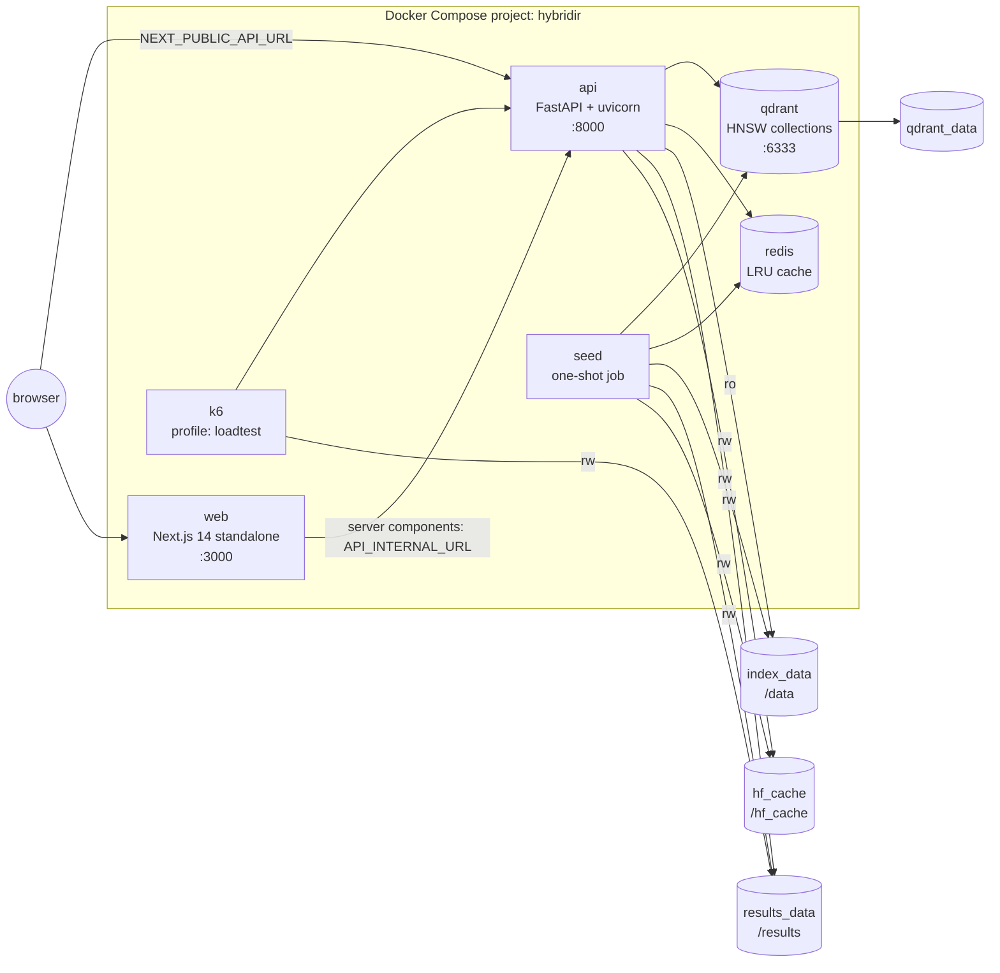
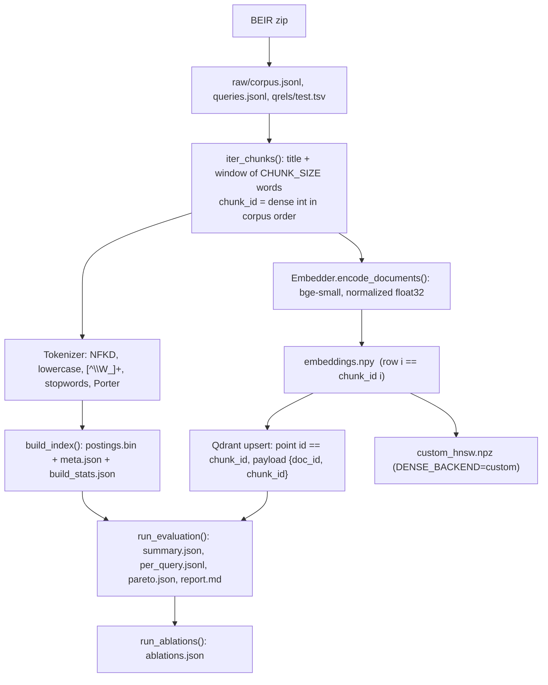
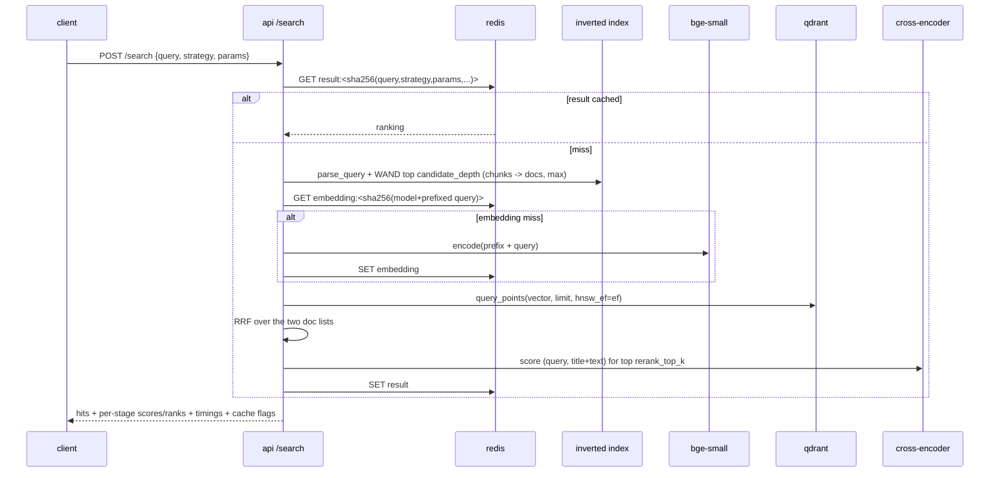

# Architecture

This document describes how HybridIR is put together: the processes, what each owns, how a
query flows through them, and the invariants that hold the pieces together. The README gives
the overview and primers; this is the reference for someone changing the code.

## Processes

| Service | Lifecycle | Owns | Reads |
|---|---|---|---|
| `qdrant` | long-running | `qdrant_data` (collections `<dataset>_m<M>_efc<efc>`) | – |
| `redis` | long-running, no persistence | query-embedding cache, result cache, hit/miss hash `hybridir:stats` | – |
| `seed` | runs once per `up`, exits 0 | downloads into `hf_cache`, builds into `index_data`, writes `results_data` | BEIR zip over HTTPS |
| `api` | long-running | background evaluation writes to `results_data` | `index_data` (read-only mmap), `hf_cache` |
| `web` | long-running | – | the api over HTTP |
| `k6` | on demand (`--profile loadtest`) | `results_data/k6_summary.json` | `results_data/queries.json` |

## Startup sequence

1. `qdrant` and `redis` start; their healthchecks gate everything else.
2. `seed` waits for both, then (idempotently): downloads model snapshots to `HF_HOME`,
   downloads and extracts the BEIR zip, builds the inverted index, embeds every chunk, upserts
   the vectors and waits until Qdrant reports the HNSW index built, writes the idempotency
   marker, exports `queries.json` for k6, and runs the baseline evaluation (plus ablations when
   `ABLATIONS_ON_SEED=true`). Exit code 0 is required for the api to start.
3. `api` loads the index via `mmap`, the corpus into memory, both models from the local cache
   (`HF_HUB_OFFLINE=1`) and connects to Qdrant/Redis. `/ready` turns 200 when every check passes.
4. `web` starts once the api is healthy.

## Seed data flow

## The chunk-id invariant

Everything joins on the **chunk id**: a dense integer assigned by `iter_chunks()` in corpus
file order. The same id is

- the postings-list document id in `postings.bin`,
- the row of `embeddings.npy`,
- the Qdrant point id, and
- the node id in the custom HNSW graph.

`InvertedIndex.chunk_doc[cid]` maps it back to the BEIR document id. Both retrievers
aggregate chunk scores to documents with **max**, so documents are what get fused, reranked
and evaluated. Changing `CHUNK_SIZE` therefore invalidates every artifact, which is why it is
part of the seed fingerprint.

## Query path (hybrid_rrf_rerank)

Timings are measured with `time.perf_counter()` around each stage inside the request:
`tokenize_ms, bm25_ms, embed_ms, ann_ms, fusion_ms, rerank_ms, total_ms`.

## Failure isolation

| Failure | Effect | Where handled |
|---|---|---|
| Qdrant unreachable | `dense` and every hybrid strategy return **503** `{"error":"stage_unavailable","stage":"dense"}`; `bm25` keeps working; `/compare` returns per-column errors; `/ready` is 503 | `SearchPipeline.dense_candidates`, `api/errors.py` |
| Reranker failed to load | `*_rerank` strategies return 503 with `stage: "rerank"` | `SearchPipeline.rerank_scores` |
| Redis unreachable | caching silently disabled (fail-open), counters fall back to process memory; `/ready` reports redis not ok | `core/cache.py` |
| Index missing (seed not run) | all search endpoints 503 `index_not_loaded`; metrics endpoints still answer | `deps.build_state`, `require_pipeline` |
| Slow request | 504 after `SEARCH_TIMEOUT_SECONDS` | `api/errors.run_blocking` |

## Concurrency model

uvicorn runs one worker. Endpoints are `async` and push CPU-bound work into Starlette's
thread pool (`run_in_threadpool`) under a timeout. The index is read-only and mmap-backed,
cursors are per-request objects, models are loaded once behind a lock, and torch inference
releases the GIL, so concurrent requests are safe. For more throughput, raise
`TORCH_THREADS` carefully (oversubscription hurts) or run more api replicas behind a load
balancer; each replica maps the same index file and shares the Redis cache.

## Why the model weights live in a volume

The backend image stays small and generic (no 400 MB of weights baked in); the seed service
downloads both snapshots into the `hf_cache` volume on the first run, skipping ONNX/OpenVINO
exports. The api runs with `HF_HUB_OFFLINE=1`, so after the first run nothing touches the
network, and the seed checks the cache with `local_files_only=True` before downloading.
